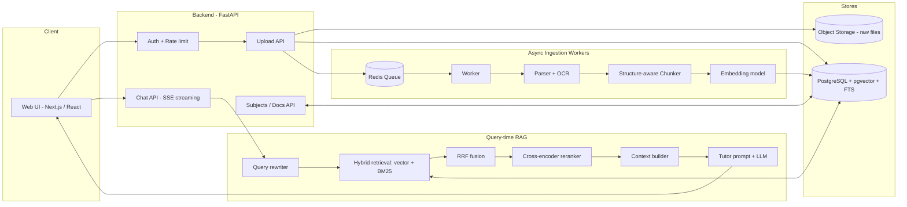
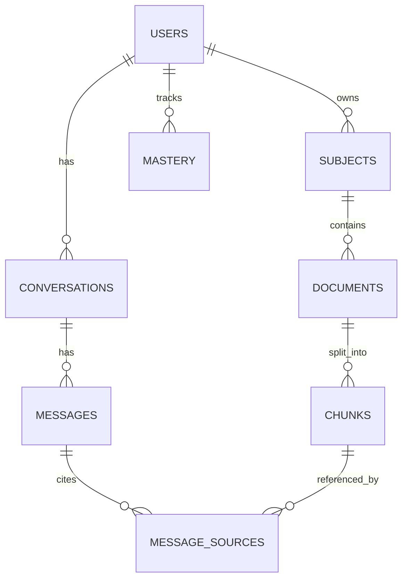

# AI Personal Tutor (RAG) — Architecture

## 1. Goal

Students upload their own notes and PDFs, organised by subject. A chatbot reads and understands that material, then **answers questions and explains concepts like a personal tutor**, grounded in the student's own content, with page-level citations.

### Functional requirements
- Upload PDF, DOCX, PPTX, TXT/MD (and scanned/handwritten-style PDFs via OCR).
- Organise content into **subjects** (e.g. Physics, DBMS).
- Ask questions in chat; get explanations grounded in uploaded material with citations (`file, page`).
- Tutor behaviours: explain, simplify (ELI5), step-by-step, worked examples, quiz me, summarise a chapter, Socratic mode.
- Follow-up questions understand chat context.
- Honest fallback: if the notes don't cover something, say so, then optionally give a clearly-labelled general explanation.

### Non-functional requirements
- **Isolation:** a student can only ever retrieve their own documents.
- **Accuracy over fluency:** low hallucination, answers traceable to sources.
- **Latency:** first token < 2 s, full answer < 10 s (streaming).
- **Ingestion:** a 100-page PDF indexed in < 2 min, async, with visible status.
- **Cost-aware:** cheap local embeddings; LLM only at generation time.

---

## 2. High-Level Architecture

Two pipelines share one store:
1. **Ingestion (offline, async):** file → text → chunks → embeddings → DB.
2. **Query (online, streaming):** question → rewrite → hybrid retrieve → rerank → prompt → LLM → cited answer.

---

## 3. Ingestion Pipeline

| Stage | What happens | Tooling |
|---|---|---|
| 1. Upload | Validate type/size, store raw file, create `documents` row (`status=queued`), enqueue job | FastAPI, MinIO/S3 or local disk |
| 2. Parse | Extract text per page with layout info. Detect headings by font size. | PyMuPDF, python-docx, python-pptx |
| 3. OCR fallback | If a page has almost no extractable text, rasterise and OCR | Tesseract (or a vision LLM for handwriting) |
| 4. Clean | Remove repeated headers/footers, fix hyphenation, normalise whitespace | Custom rules |
| 5. Chunk | Split **by section first**, then by size (~500 words, ~60 word overlap). Keep `section_path` and page range | Custom chunker |
| 6. Embed | Batch-embed each chunk, prefixing the section path for context | bge-small / bge-m3 / OpenAI-compatible |
| 7. Index | Insert into `chunks` with vector + generated `tsvector` | Postgres + pgvector |
| 8. Status | Update `documents.status` → `ready` / `failed`, expose progress to UI | Redis/DB |

### Chunking principles
- Never split in the middle of a heading's body if it fits; headings travel with their content.
- Chunk text stored = body; **embedded text = `section_path + body`** (contextual embedding improves recall).
- Store `page_start`, `page_end` for citations.
- Optional upgrade: LLM-generated chunk summary/“hypothetical questions” stored for extra retrieval signals.

---

## 4. Query (RAG) Pipeline

1. **Auth + scope:** resolve `user_id`, `subject_id` (or “all subjects”).
2. **Query rewriting:** turn follow-ups (“why does it do that?”) into standalone queries using the last few turns.
3. **Hybrid retrieval** (filtered by `user_id` and `subject_id`):
   - Dense: pgvector cosine, top 30.
   - Sparse: Postgres full-text (`websearch_to_tsquery`), top 30 — catches exact terms, formulas, acronyms.
4. **Fusion:** Reciprocal Rank Fusion (RRF, k=60) → top ~20.
5. **Rerank:** cross-encoder (bge-reranker) → top 5–6.
6. **Relevance gate:** if best rerank score < threshold → “not found in notes” path.
7. **Context building:** number sources `[S1]…[S6]`, include file name + page; dedupe; trim to token budget.
8. **Generation:** tutor system prompt + sources + chat history → LLM, **streamed**.
9. **Post-process:** map `[S#]` tags back to `{file, page, snippet}` and send as a `sources` event to the UI.

---

## 5. Tutor Layer

The tutor is a **prompt + policy layer** on top of retrieval, not a separate model.

### Modes (selected by UI toggle or auto-detected from intent)
| Mode | Behaviour |
|---|---|
| Explain (default) | Intuition first → definition → example → common mistake → 1 check question |
| ELI5 / Simplify | Analogies, no jargon |
| Step-by-step | Numbered derivation / worked solution |
| Quiz me | Generate MCQs/short answers from retrieved material; grade the student's reply |
| Socratic | Guide with questions, reveal answer only after attempts |
| Summarise | Chapter/topic summary using broader retrieval (map-reduce over a document’s chunks) |

### Grounding rules (in the system prompt)
- Use only the provided sources for factual claims about the student's material; cite with `[S#]`.
- If sources are insufficient, say so explicitly; any outside knowledge is labelled **“General knowledge (not from your notes)”**.
- If the notes contradict standard knowledge, point it out gently.
- Adapt level to the student (optional learner profile: grade, weak topics).

### Learner memory (phase 2)
Track `topic → mastery`, recent confusions, and quiz results to personalise explanations and revision suggestions.

---

## 6. Data Model

Key tables: `users`, `subjects`, `documents(status, file_path, page_count)`, `chunks(content, section_path, page_start, page_end, embedding, tsv)`, `conversations`, `messages`, `message_sources`, `mastery` (phase 2). Full DDL is in `implementation.md`.

---

## 7. Technology Choices

| Concern | Choice (MVP) | Why | Alternatives |
|---|---|---|---|
| Backend | FastAPI (Python) | Best ML/RAG ecosystem, async, SSE | Node/NestJS |
| Frontend | Next.js + Tailwind | Streaming chat UI, file upload | Streamlit (fastest prototype) |
| Vector + keyword store | **PostgreSQL + pgvector + FTS** | One DB for relational + vector + BM25-style search; simple ops | Qdrant, Weaviate, Chroma |
| Queue | Redis + RQ | Minimal setup | Celery, Arq |
| Raw file storage | Local disk → MinIO/S3 | Swap without code changes | GCS |
| PDF parsing | PyMuPDF (+ Tesseract OCR) | Fast, layout-aware | Docling, Unstructured, LlamaParse |
| Embeddings | `BAAI/bge-small-en-v1.5` (local, 384-d) | Free, strong, CPU-friendly | `bge-m3` (multilingual), OpenAI/Voyage |
| Reranker | `BAAI/bge-reranker-base` | Big precision gain | Cohere Rerank |
| LLM | Claude via Anthropic API (configurable) | Strong explanations, long context, instruction following | Any OpenAI-compatible model |
| Auth | JWT (stub in MVP) → OAuth/Clerk/Auth0 | | |
| Observability | Structured logs + Langfuse (optional) | Trace retrieval + prompts | OpenTelemetry |

> **Multilingual note:** if students write notes in Indian languages or mix languages, switch to `bge-m3` and the `simple` FTS config (or add per-language configs).

---

## 8. Security & Privacy

- **Row-level isolation:** every retrieval query is filtered by `user_id` (enforced in code; optionally Postgres RLS).
- Signed, short-lived URLs for raw file download; files never publicly listable.
- Upload limits (size, page count, MIME sniffing), virus scan hook.
- **Prompt-injection defence:** uploaded documents are *data*. The prompt wraps sources in delimiters and instructs the model to ignore any instructions found inside them.
- Rate limiting per user; max upload quota.
- PII: don't log full document text; allow users to delete documents (cascade removes chunks + files).
- Encrypt at rest (disk/S3 SSE) and in transit (TLS).

---

## 9. Scalability Path

| Stage | Setup |
|---|---|
| MVP / demo (≤100 users) | Single VM, Docker Compose, Postgres+pgvector, one worker |
| Growth (≤10k users) | Separate API and worker containers, HNSW index tuning, GPU/hosted embeddings & reranker, S3 |
| Scale | Read replicas, partition `chunks` by user hash, or move vectors to Qdrant; autoscaled workers |

Caching: embed-cache for repeated queries; response cache keyed by `(subject, normalised question)` for common questions.

---

## 10. Evaluation Strategy

Build a **golden set** (30–100 Q&A pairs from sample notes) and track:

| Layer | Metric |
|---|---|
| Retrieval | Recall@k, MRR, nDCG — did the right chunk appear? |
| Generation | Faithfulness (every claim supported by sources), answer relevance, citation accuracy |
| Tutor quality | Rubric: clarity, correct level, includes example/check question |
| System | p50/p95 latency, cost per answer, ingestion time |
| Product | Thumbs up/down, “not helpful” reasons, follow-up rate |

Run the eval script on every change to chunking, embeddings, prompts, or models (regression gate in CI).

---

## 11. Risks & Mitigations

| Risk | Mitigation |
|---|---|
| Poor PDF extraction (tables, equations, scans) | OCR fallback, optional vision-LLM parsing for equation-heavy pages, keep page images for “view source” |
| Hallucination | Relevance gate, strict grounding prompt, citations, faithfulness eval |
| Handwritten notes | Vision LLM transcription step (phase 2) |
| Retrieval misses on vague questions | Query rewriting, hybrid search, multi-query expansion |
| Cost spikes | Cap context tokens, cache, smaller model for rewriting/classification |
| Long “summarise whole book” requests | Map-reduce summarisation per section, cached per document |

---

## 12. Roadmap

| Phase | Deliverable |
|---|---|
| **1 – MVP (1–2 wks)** | Upload PDF → parse → chunk → embed → pgvector; chat with citations; single subject |
| **2 – Quality (1–2 wks)** | Hybrid search + reranker, query rewriting, OCR, relevance gate, subjects, streaming UI |
| **3 – Tutor features** | Modes (ELI5, quiz, Socratic), summaries, flashcards |
| **4 – Personalisation** | Mastery tracking, revision plans, spaced repetition |
| **5 – Hardening** | Auth, quotas, eval CI, observability, deployment |
